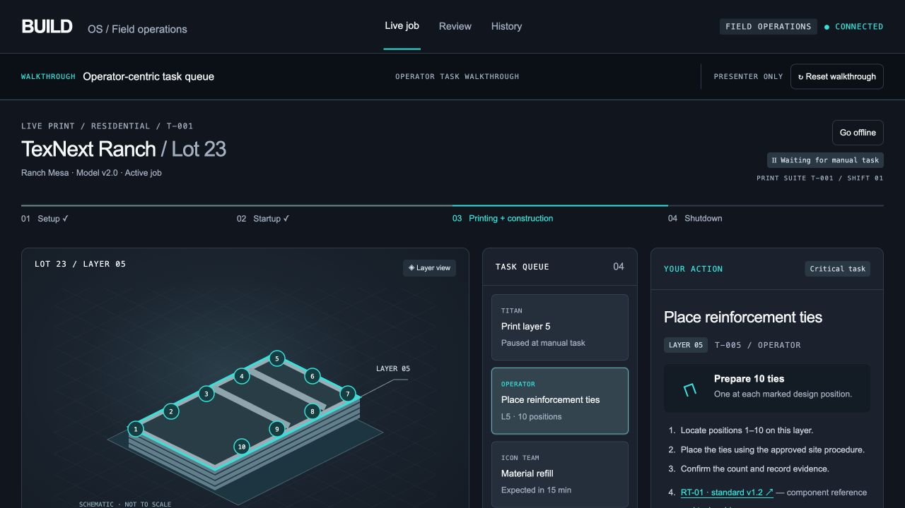
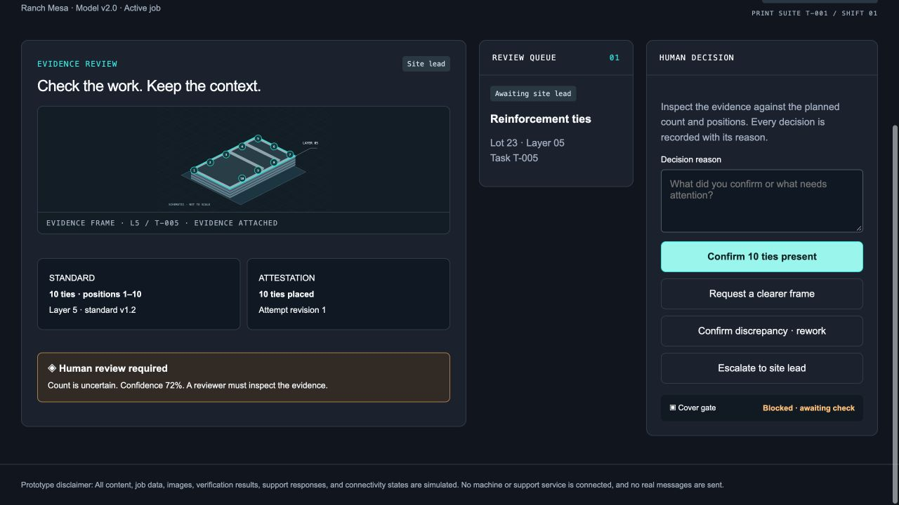
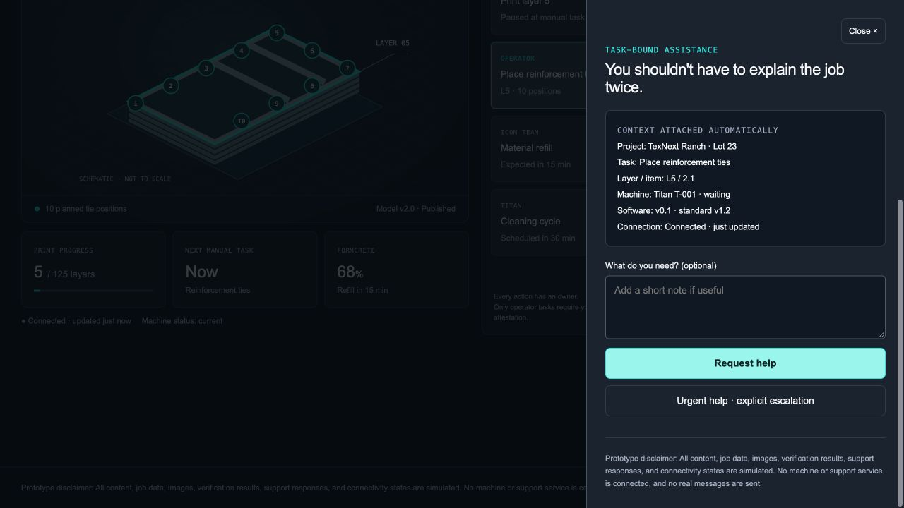
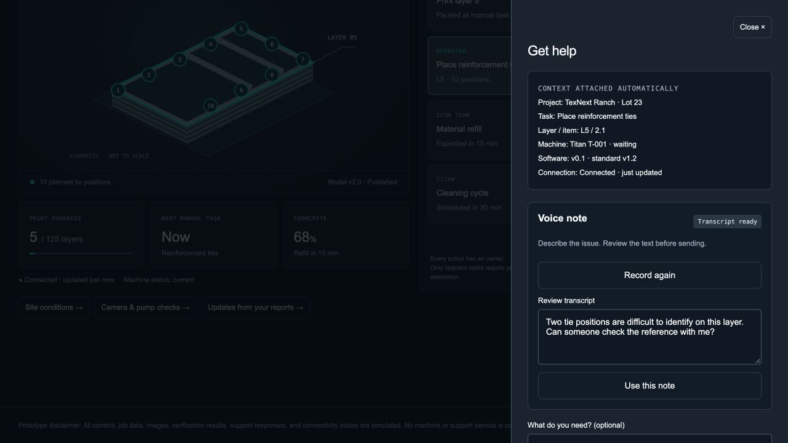
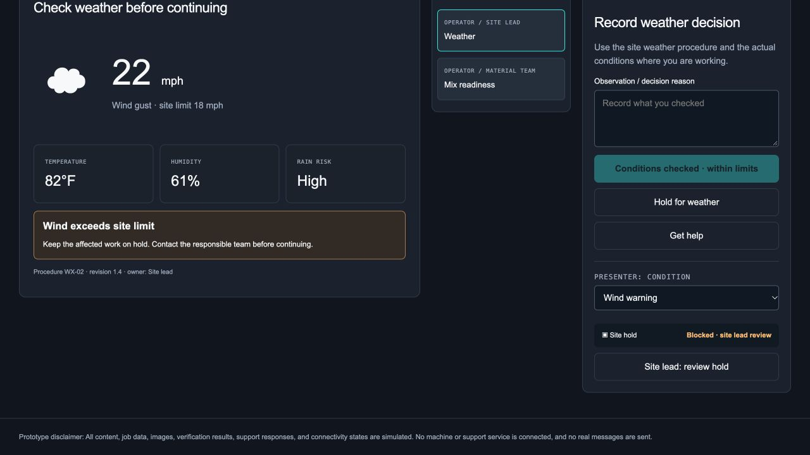
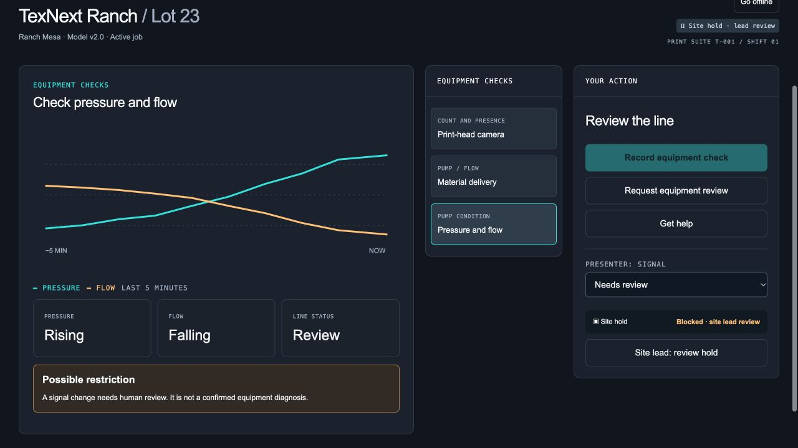
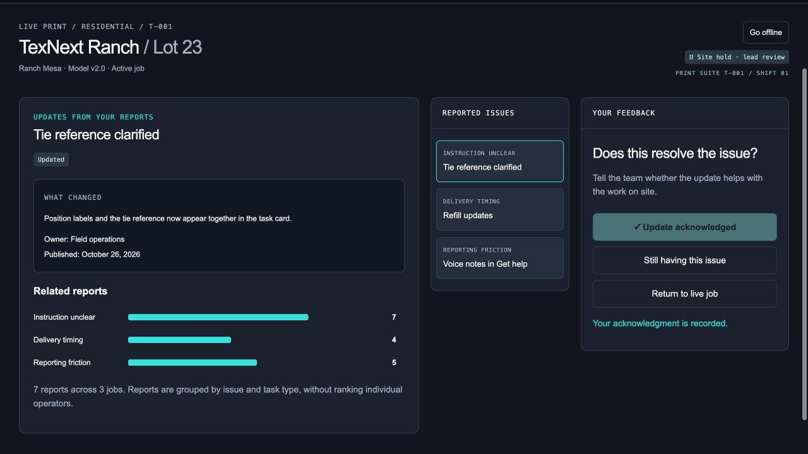
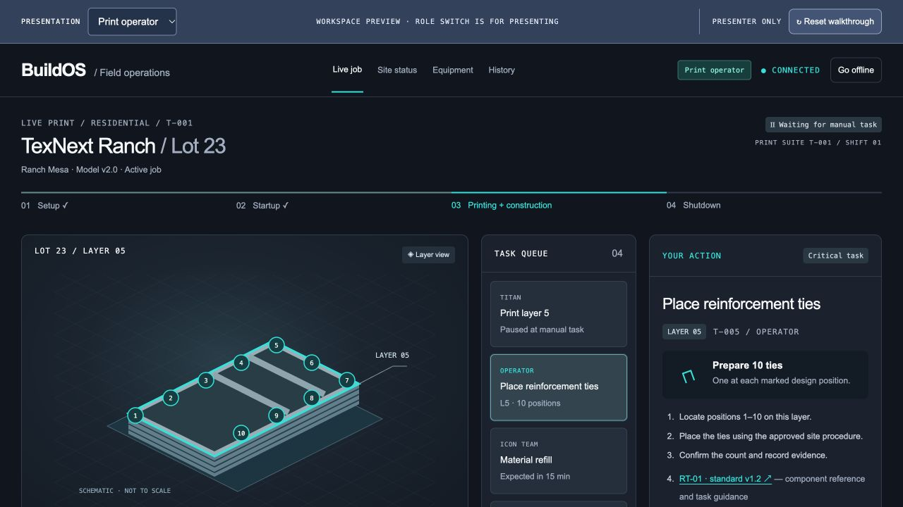
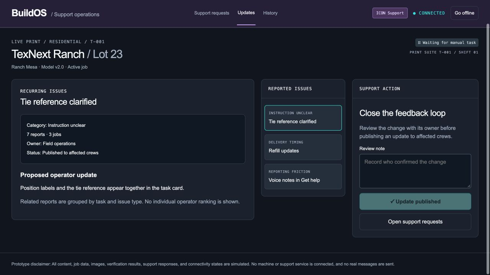

# Print Operator — Interactive Prototype

[Open the live prototype](https://printoperator-mock.bronzegiant10.chatgpt.site)

A clickable proposal for a BuildOS-inspired live-job operator experience. The published link is public; no GitHub access, installation or sign-in is required.

## Operator-centric task queue

Print visual → task queue → Your Action. Each action names its owner; the critical manual task includes layer-specific positions, component reference and count attestation.



## Verify before cover-up

Acknowledge the task, confirm the placed count, capture a frame and select a verification outcome in the evidence step. Count matches, human review, retake and discrepancy/rework are branches of the same workflow.



## Help in context

Get help attaches the job, task, layer, machine state and version. Flag issue records a reason in two clicks. Offline/reconnect states are available above the job status; Reset walkthrough is a presenter-only control.



## Run locally

Open `prototype.html` directly, or run:

```sh
python3 -m http.server 4173 --bind 127.0.0.1
```

Visit http://127.0.0.1:4173. No dependencies or build step are needed. `index.html`, `style.css`, `app.js`, and `p1.js` are the editable source; `prototype.html` is the standalone copy.

## Scope

All content, job data, images, verification results, support responses and connectivity states are simulated. No machine or support service is connected and no real messages are sent. State exists for the current page session and resets on reload. This prototype does not certify installation quality or structural acceptance. P1 flows are included as scripted interactions; hardware, AI and support integrations are not connected.

## P1 feature walkthroughs

- **Get help:** record/stop a voice note, edit its transcript, send the note, review suggested routing, and follow an urgent callback. No microphone or transcription API is used.
- **Site status:** weather/mix checks, decision reasons, holds and site-lead release. All readings, limits and procedures are illustrative.
- **Equipment:** camera-frame handoff, refill confirmation and pressure/flow alerts. Signals are scenario fixtures, not hardware feeds.
- **Updates:** related issues, changes made, acknowledgment and a still-having-this-issue route.

Choose a feature in the walkthrough bar or use the top navigation. Each opens directly to its own view. Presenter condition/signal controls exercise warning branches.









## Role-separated workspaces and test scenarios

Use the blue Presentation row to switch between **Print operator** (navy/turquoise), **Site lead** (amber), and **ICON Support** (purple). This is a presenter role preview, not production login or access control. Operator navigation includes Live job, Site status, Equipment and History. Support requests and Updates belong to ICON Support.

[Read the step-by-step scenario test guide](docs/SCENARIO-TEST-GUIDE.md) — 12 scenarios, expected outcomes, cross-role handoffs and a defect log.




